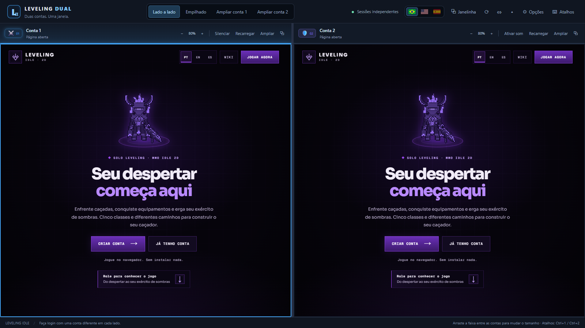
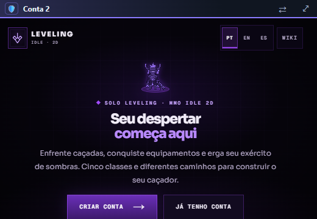
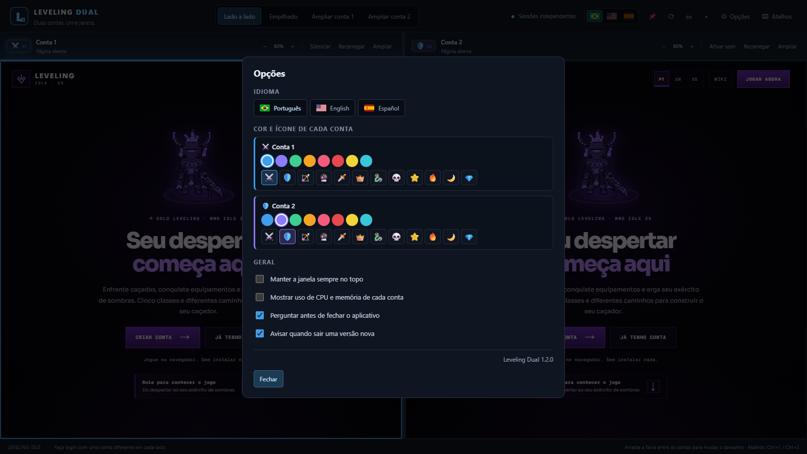

# Leveling Dual

**Duas contas de Leveling Idle 2D. Uma janela.**

🇧🇷 Português · 🇺🇸 English · 🇪🇸 Español

### [⬇️ Baixar a versão mais recente](https://github.com/bruno220218/leveling-dual/releases)

---

## ✨ O que ele faz

| | |
|---|---|
| 🧩 **Duas contas, dois logins** | Cada lado tem sua própria sessão. Você entra uma vez e o login fica salvo. |
| ↔️ **Lado a lado ou empilhado** | Arraste a faixa entre as contas para dar mais espaço a uma delas; duplo clique centraliza. |
| 🔍 **Ampliar uma conta** | Dá a janela inteira para uma conta sem fechar a outra. Esc volta. |
| 🎯 **Conta ativa visível** | A borda colorida mostra qual conta recebe o teclado. |
| 🎨 **Cor e ícone por conta** | Escolha uma cor e um ícone para cada conta e nunca mais confunda os personagens. |
| 🌎 **Três idiomas** | Português, inglês e espanhol, trocando pelas bandeirinhas da barra. |
| ⧉ **Janelinha flutuante** | Leva uma conta para uma janela pequena por cima de tudo, para acompanhar enquanto usa outro programa. A outra conta continua rodando. |
| ⟳ **Recarregar as duas** | Reabre o jogo nas duas contas de uma vez. |
| 📊 **Uso de CPU e memória** | Mostra quanto cada conta está consumindo. Fica desligado até você ligar nas Opções. |
| 🔔 **Aviso de versão nova** | Ao abrir, avisa quando sair uma versão nova aqui nas Releases. Não baixa nada sozinho. |
| 🎚️ **Controles por conta** | Nome, zoom, som e recarregar em cada lado. A segunda conta começa sem som. |
| 🖥️ **Barra escondível** | Ctrl+B esconde a barra e o rodapé para ganhar espaço. |
| 💾 **Lembra tudo** | Tamanho da janela, divisão, nomes, zoom, som, idioma, cores e ícones continuam iguais na próxima vez. |

> [!IMPORTANT]
> O jogo permite **no máximo 2 contas por pessoa**, então o aplicativo abre só duas. Usar mais contas pode dar banimento.

## ⧉ Janelinha flutuante

O botão **Janelinha** (ou <kbd>Ctrl</kbd> + <kbd>P</kbd>) leva a conta ativa para uma janela pequena que fica por cima de tudo. A janela grande é minimizada e a outra conta continua rodando nela. Na faixa de cima: **⇄** troca a conta e **⤢** (ou <kbd>Esc</kbd>) volta para a janela grande.

## ⚙️ Opções

No botão **Opções** (ou clicando no ícone da conta) você escolhe o idioma, a cor e o ícone de cada conta e liga ou desliga: uso de CPU e memória, pergunta antes de fechar e aviso de versão nova.

## 📥 Como usar

1. Abra a página de [**Releases**](https://github.com/bruno220218/leveling-dual/releases) e baixe o **`Leveling-Dual.zip`** da versão mais recente.
2. Extraia o zip **inteiro** para uma pasta.
3. Dê dois cliques em **`LevelingDual.exe`**.
4. Entre na primeira conta no lado esquerdo e na segunda no lado direito.

Quem já usava uma versão anterior continua com as mesmas contas logadas.

> [!TIP]
> Se o Windows mostrar "O Windows protegeu o computador", clique em **Mais informações → Executar assim mesmo**. O aviso aparece porque o aplicativo não tem assinatura paga da Microsoft.

## ⌨️ Atalhos

| Tecla | O que faz |
|---|---|
| <kbd>Ctrl</kbd> + <kbd>1</kbd> / <kbd>2</kbd> | Ativa a conta 1 ou 2 |
| <kbd>Ctrl</kbd> + <kbd>Tab</kbd> | Troca de conta |
| <kbd>Ctrl</kbd> + <kbd>Shift</kbd> + <kbd>1</kbd> / <kbd>2</kbd> | Amplia a conta (<kbd>Esc</kbd> volta) |
| <kbd>F5</kbd> ou <kbd>Ctrl</kbd> + <kbd>R</kbd> | Recarrega a conta ativa |
| <kbd>Ctrl</kbd> + <kbd>Shift</kbd> + <kbd>R</kbd> | Recarrega as duas contas |
| <kbd>Ctrl</kbd> + <kbd>M</kbd> | Liga ou desliga o som da conta ativa |
| <kbd>Ctrl</kbd> + <kbd>+</kbd> / <kbd>−</kbd> / <kbd>0</kbd> | Zoom da conta ativa |
| <kbd>Ctrl</kbd> + <kbd>P</kbd> | Janelinha flutuante (<kbd>Esc</kbd> volta) |
| <kbd>Ctrl</kbd> + <kbd>B</kbd> | Esconde ou mostra a barra |
| <kbd>F11</kbd> | Tela cheia |

As teclas sem <kbd>Ctrl</kbd> continuam indo para o jogo normalmente.

## 🛡️ Segurança

- O aplicativo **não lê nem guarda senhas**. O login fica na sessão do próprio site, como num navegador.
- As páginas do jogo rodam isoladas, sem acesso ao seu computador.
- Links de fora do jogo abrem no seu navegador.
- Não há macro, clique automático, proxy ou qualquer alteração no jogo. O teclado controla só a conta que você clicar.
- O aviso de versão só consulta a lista pública de Releases deste repositório; nenhum dado seu é enviado.
- O código-fonte vai junto em cada versão, no arquivo `Codigo-fonte.zip`.

## 👥 Créditos

<table>
  <tr>
    <td align="center" width="160">
      <a href="https://github.com/bruno220218"> <b>bruno220218</b></a> 
      Criador
    </td>
    <td align="center" width="160">
      <a href="https://github.com/SkymerLight"> <b>SkymerLight</b></a> 
      Colaborador
    </td>
  </tr>
</table>

Aplicativo independente, sem vínculo oficial com o Leveling Idle 2D.

